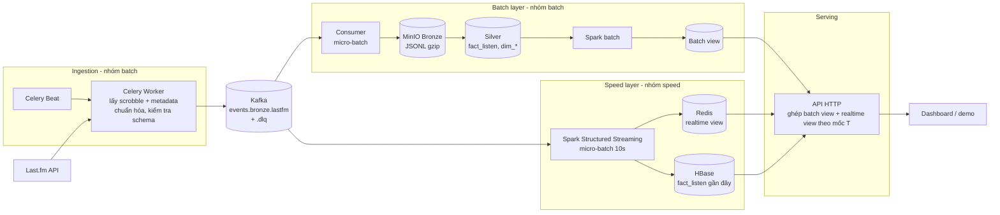

# Kiến trúc tổng quan và thỏa thuận tích hợp batch – speed

> **Bản nháp, chờ nhóm batch duyệt.** Tài liệu chỉ coi là đã chốt khi PR được merge vào `main`.
>
> Code `producer/` (nhánh `batch/producer`) và `stream/` (nhánh `realtime-streaming`) **chưa có trên `main`**, nên các link tới code trong tài liệu chỉ mở được sau khi hai nhánh đó được merge.

Cập nhật: 2026-11-13. Tài liệu này mô tả kiến trúc chung của project và những điểm nhóm batch và nhóm speed phải dùng giống nhau.

**Đã chốt:** producer của nhóm batch (`producer/`, nhánh `batch/producer`) là **nguồn dữ liệu vào duy nhất**. Producer cũ của speed (`stream/producer/produce_scrobbles.py`) ngừng dùng cho dữ liệu thật.

Mục 6 là các câu hỏi chưa có câu trả lời. Mỗi câu kèm một phương án đề xuất.

---

## 1. Tổng quan

Project theo kiến trúc **Lambda**:

- **Một nguồn vào:** producer → Kafka.
- **Hai nhánh xử lý song song:**
  - **Batch:** chậm, tính lại trên toàn bộ lịch sử, cho kết quả chính xác.
  - **Speed:** nhanh, chỉ tính phần dữ liệu mới, cho kết quả tạm thời.
- **Tầng serving** ghép kết quả của hai nhánh rồi trả cho người dùng.



| Thành phần | Nhóm | Code | Ghi chú |
|---|---|---|---|
| Producer (Celery Beat + Worker) | batch | `producer/` (nhánh `batch/producer`) | Mỗi giờ lấy trọn giờ trước của từng user |
| Kafka | chung | một broker duy nhất | Phải gộp hai compose hiện có (mục 3.1) |
| Consumer → MinIO Bronze | batch | chưa có | Theo đặc tả `docs/batch_pipeline.md` (nhánh `main`) |
| Silver, Spark batch, batch view | batch | chưa có | Nhóm batch bổ sung mục 4.1 |
| Spark speed layer, Redis, HBase | speed | `stream/processing/`, `stream/storage/` (nhánh `realtime-streaming`) | Đã chạy với topic cũ `scrobble.raw` |
| API serving | speed (tạm) | `stream/api/server.py` | Hiện mới đọc dữ liệu của speed |

---

## 2. Luồng dữ liệu

1. **Lập lịch.** Celery Beat chạy ở phút 0 mỗi giờ, tạo cho mỗi user một task kèm `trigger_time` (Unix giây, UTC). Worker nhận task trễ hay phải chạy lại thì vẫn dùng đúng mốc này.
2. **Lấy dữ liệu.** Worker gọi `user.getRecentTracks` cho cửa sổ `[trigger_time − 3600, trigger_time)`. Với mỗi scrobble, worker gọi thêm `track.getInfo`, `artist.getInfo`, `album.getInfo`, rồi gộp thành **một event** và kiểm tra theo JSON Schema.
3. **Ghi Kafka.** Event hợp lệ vào topic `events.bronze.lastfm`. Event lỗi vào `events.bronze.lastfm.dlq`, kèm lý do. Key là username. Producer bật idempotence và `acks=all`. Bản sao của mỗi lần chạy được lưu ở `data/producer/runs/` để gửi lại khi cần.
4. **Batch.** Consumer gom message rồi ghi xuống MinIO Bronze. Chỉ khi upload thành công mới commit offset. Từ Bronze, Spark batch tạo Silver (`fact_listen`, các bảng `dim_*`), rồi tính batch view.
5. **Speed.** Spark Structured Streaming đọc **cùng topic** với một consumer group riêng, cứ 10 giây một micro-batch. Nó khử trùng theo `event_id` bằng Redis, cập nhật realtime view trên Redis, và ghi `fact_listen` gần đây vào HBase.
6. **Serving.** API đọc batch view cho phần dữ liệu ≤ T, cộng realtime view cho phần > T (mục 5).

---

## 3. Hợp đồng dữ liệu (hai nhóm phải dùng giống nhau)

### 3.1. Kafka

| Mục | Giá trị |
|---|---|
| Broker | **Một** Kafka chung. Trong Docker network dùng `kafka:9092`, từ máy host dùng `localhost:19092` (theo `compose.producer.yml`). |
| Topic chính | `events.bronze.lastfm`, 3 partition |
| Topic lỗi | `events.bronze.lastfm.dlq` |
| Topic demo | `events.demo.lastfm` (`source = demo`), không trộn với dữ liệu thật |
| Key | username Last.fm |
| Value | một event JSON UTF-8 theo schema mục 3.2 |
| Consumer group | batch: `batch-bronze-sink`; speed: do Spark tự quản qua checkpoint. Hai nhóm không dùng chung group. |
| Lưu giữ (retention) | Ít nhất bằng thời gian consumer batch có thể ngừng chạy mà không mất dữ liệu. Đề xuất 7 ngày. |

Kafka bên speed (`docker-compose.yml`, `apache/kafka:3.8.0`, cổng 9092) **sẽ bỏ**. Cả project dùng chung một file compose, hoặc một network chung, với Kafka `apache/kafka:4.4.0` của producer.

### 3.2. Schema message

Code kiểm tra schema là [`producer/schema.py`](../producer/schema.py) (`schema_version = "1.0"`). Lệnh xuất JSON Schema:

```powershell
docker compose -f compose.producer.yml run --rm --no-deps app python -m producer schema
```

| Nhóm trường | Nội dung chính |
|---|---|
| Phần bao ngoài | `schema_version`, `event_id`, `source` (`lastfm`/`demo`), `trigger_time`, `ingested_at` (ISO 8601, UTC), `metadata_errors[]` |
| `scrobble_event` | `name`, `mbid`, `loved` (`"0"`/`"1"`), `date.uts` (chuỗi số, Unix giây), `artist{name,mbid}`, `album{name,mbid}`, `image[]` |
| `user_profile` | `name` (username), `country`, `playcount`, `registered`, … |
| `track_metadata` | `duration` (ms, dạng chuỗi), `listeners`, `playcount`, `userplaycount`, `toptags.tag[]`, `wiki` |
| `artist_metadata` | `stats.userplaycount`, `similar.artist[]`, `tags.tag[]`, `bio` |
| `album_metadata` | `playcount`, `userplaycount`, `tracks.track[]`, `wiki` |

Quy ước: trường mà API không trả về để `null` hoặc danh sách rỗng, **không** tự điền 0. Các số liệu metadata là ảnh chụp tại lúc crawl, không phải giá trị tại lúc nghe.

Đổi schema (thêm, bớt hay đổi kiểu trường) thì phải tăng `schema_version` và báo cho cả hai nhóm.

### 3.3. Khóa

| Khóa | Công thức | Ai tính |
|---|---|---|
| `event_id` | `"lastfm:" + sha256(json([username.casefold(), uts, artist_name, track_name, album_name]))` | **Producer**, có sẵn trong message. Consumer **không tự tính lại**. |
| `user_id` | `username.strip().lower()` | Consumer |
| `track_id` | `"t:" + sha1(artist_norm ␟ track_norm)[:16]` | Consumer |
| `artist_id` | `"a:" + sha1(artist_norm)[:16]` | Consumer |
| `album_id` | `"al:" + sha1(artist_norm ␟ album_norm)[:16]` | Consumer |

- `*_norm = normalize_text(tên)`: chuẩn hóa NFKC, casefold, gộp khoảng trắng, giữ dấu tiếng Việt. Ký tự ␟ là `\x1f`.
- Code tham chiếu là [`stream/common/ids.py`](../stream/common/ids.py) (nhánh `realtime-streaming`). Batch nên **import thẳng file này** hoặc bọc nó thành UDF, không tự viết lại.
- Các khóa thực thể **không dùng MBID**, vì MBID lúc có lúc không với cùng một bài.
- Công thức `event_id` cũ của speed (`sha1(user_id, listened_at, track_id)[:32]`) **bỏ**. Từ giờ chỉ dùng `event_id` lấy từ message.

### 3.4. Thời gian

- Mọi timestamp lưu ở dạng **Unix giây UTC**.
- `listened_date`, `hour` tính theo **UTC**. `dow` theo ISO: 1 = Thứ hai … 7 = Chủ nhật.
- Muốn hiển thị theo giờ Việt Nam thì chuyển ở tầng hiển thị, không chuyển trong dữ liệu.

### 3.5. Ánh xạ message → `fact_listen`

Hai layer phải ra **cùng một dòng** `fact_listen` (danh sách trường trong `docs/fields.csv`) từ cùng một message:

| Trường `fact_listen` | Lấy từ |
|---|---|
| `event_id` | `event_id` |
| `user_id` | `lower(user_profile.name)` |
| `listened_at` | `int(scrobble_event.date.uts)` |
| `listened_date`, `dow`, `hour` | tính từ `listened_at`, theo UTC |
| `track_name` / `track_norm` / `track_id` / `track_mbid` | `scrobble_event.name`, chuẩn hóa, mục 3.3; MBID rỗng thì `null` |
| `artist_*` | `scrobble_event.artist.{name,mbid}` |
| `album_*` | `scrobble_event.album.{name,mbid}`; tên rỗng thì `album_id = null` |
| `loved` | `scrobble_event.loved == "1"` |
| `duration_ms` | `int(track_metadata.duration)`; `null` hoặc `"0"` thì `null` |
| `tags` | tối đa 5 `name` đầu trong `track_metadata.toptags.tag`; nếu rỗng thì lấy từ `artist_metadata.tags.tag` |
| `tag_source` | `"track"`, `"artist"`, hoặc `null` nếu không có tag |
| `crawled_at` | `ingested_at` chuyển sang Unix giây |

Đề xuất đặt hàm ánh xạ chung ở `stream/common/fact_listen.py` (hiện đang đọc định dạng cũ, sẽ sửa theo bảng trên) và có test với cùng một message mẫu cho cả hai nhóm.

---

## 4. Batch view và realtime view

### 4.1. Batch view (nhóm batch bổ sung)

Cần ghi rõ:

- Silver lưu ở đâu: Delta hay Iceberg, đường dẫn MinIO, cách phân vùng (đề xuất theo `listened_date`).
- Batch tính ra những gì: ví dụ thống kê user theo ngày, top bài/nghệ sĩ/album, thói quen theo `dow`/`hour`, gợi ý dài hạn.
- Batch view lưu ở đâu (đề xuất HBase, bảng riêng tiền tố `batch_`), row key và các cột.
- Lịch chạy của batch.

### 4.2. Realtime view (speed, đã có)

| Dữ liệu | Nơi lưu | Thời gian giữ |
|---|---|---|
| Thống kê user theo ngày: lượt nghe, thời lượng, top bài/nghệ sĩ/album | Redis `analytics:v2:*` theo `listened_date` | 30 ngày |
| Thống kê toàn thời gian của user | Redis | 90 ngày từ lần nghe cuối. **Không đem cộng với batch** (mục 5). |
| Danh sách lượt nghe gần nhất | Redis | giới hạn theo số lượng |
| Top-K toàn cục 5 phút → 24 giờ | Redis | theo cửa sổ |
| `fact_listen` gần đây | HBase `fact_listen` | dùng cho tra cứu event |

---

## 5. Ghép hai view: mốc T

**T** là ranh giới: batch đã tính xong mọi lượt nghe có `listened_at` < T, còn speed lo phần ≥ T.

```
 ──────────────────────────────┼─────────────────────────────┤
 |<── batch view (đã tính) ───>|<── realtime view (speed) ──>|
                               T                         hiện tại
```

- **T là ranh giới ngày, 00:00 UTC.** Batch tính trọn ngày, nên khớp với các khóa theo ngày của speed.
- **Batch ghi T khi chạy xong**, vào khóa Redis `analytics:v2:batch:watermark`. Giá trị là ngày cuối cùng đã tính xong (`YYYY-MM-DD`). Chỉ ghi **sau khi** batch view đã ghi xong toàn bộ.
- **API tính:** kết quả = batch view (các ngày ≤ T) + tổng các khóa ngày của speed (các ngày > T).
- **Thống kê toàn thời gian** của speed chỉ dùng tạm khi chưa có batch view. Khi đã có thì bỏ, vì khóa này cộng dồn cả phần trước T nên ghép vào sẽ đếm hai lần.
- **Batch không được chậm quá 30 ngày** (thời gian giữ khóa theo ngày của speed). Nếu chậm hơn sẽ có khoảng trống.

---

## 6. Vấn đề còn mở

| # | Vấn đề | Đề xuất |
|---|---|---|
| 1 | **Độ trễ của speed thành 1–2 giờ.** Producer chỉ lấy trọn giờ trước nó, nên một lượt nghe lúc 07:05 phải đến khoảng 08:00 mới vào Kafka. Như vậy speed không còn gần realtime. | Cho producer chạy theo cửa sổ ngắn hơn (ví dụ 5 phút). Phải sửa `producer/window.py` (hiện bắt buộc tròn giờ) và lịch trong `celery_app.py`. Nếu nhóm chấp nhận trễ theo giờ thì ghi rõ trong báo cáo. |
| 2 | **Scrobble đến muộn bị bỏ sót.** Last.fm nhận scrobble muộn (nghe offline, client gửi sau), mà cửa sổ đã đóng thì không bao giờ lấy lại. | Mỗi lần chạy lấy chồng lên cửa sổ trước (ví dụ thêm 1 giờ về trước). Trùng lặp thì khử bằng `event_id` ở cả hai layer. |
| 3 | **Số request Last.fm.** Mỗi scrobble tốn khoảng 3 request metadata, kèm username, và cache chỉ sống trong một job. Với 406 user và 1 worker ở mức 0,4 giây/request, một vòng có thể không xong trong một giờ. | Gọi metadata **không kèm username** (dùng chung giữa các user), cache giữa các job (Redis), mặc định không lưu `wiki`/`bio`/danh sách bài của album. Cần đo thực tế với đủ số user. |
| 4 | **Redis.** Celery dùng Redis làm broker (db 0, 1); speed dùng Redis cho realtime view với `maxmemory` + `noeviction`. | Tách hai instance Redis. Nếu dùng chung thì dùng db khác nhau, nhưng giới hạn bộ nhớ áp lên cả instance. |
| 5 | **Gợi ý bài nghe tiếp** chưa làm. | Speed dùng `artist_metadata.similar` có sẵn trong message cộng với `track.getSimilar` (cache dùng chung); batch cung cấp gu dài hạn để xếp hạng lại. |

---

## 7. Việc cần làm

### Nhóm speed

- Spark đọc `events.bronze.lastfm` thay cho `scrobble.raw`. Tạo checkpoint mới.
- Đọc user từ `user_profile.name`. Khử trùng theo `event_id` của message. Lấy `duration_ms` và `tags` từ message (mục 3.5).
- Sửa `stream/common/fact_listen.py` theo mục 3.5. Bỏ công thức `event_id` cũ trong `ids.py`.
- Ngừng `produce_scrobbles.py`. Xem lại metadata worker/sink: chỉ giữ nếu còn cần dữ liệu mà message không có.
- Sửa công cụ replay và tạo dữ liệu mẫu để ra đúng schema mới.
- API đọc mốc T và ghép với batch view (mục 5).

### Nhóm batch

- Consumer Kafka → MinIO Bronze.
- Silver theo mục 3.3–3.5, dùng chung `ids.py`.
- Bổ sung mục 4.1. Ghi mốc T theo mục 5.
- Trả lời các vấn đề 1–3 ở mục 6.

### Chung

- Gộp hạ tầng về một compose hoặc một network: một Kafka, MinIO, HBase, Redis.
- Một message mẫu (đã bỏ thông tin cá nhân) và một test ánh xạ `fact_listen` dùng chung cho cả hai nhóm.
