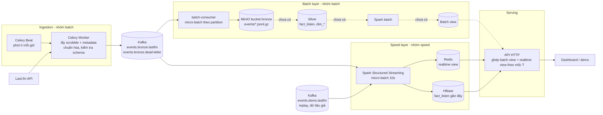

# Kiến trúc tổng quan và thỏa thuận tích hợp batch – speed

Cập nhật: 2026-11-13. Tài liệu này mô tả kiến trúc chung của project và những điểm nhóm batch và nhóm speed phải dùng giống nhau.

**Đã chốt:** producer của nhóm batch (`batch/producer/`) là **nguồn dữ liệu vào duy nhất**. Producer cũ của speed (`stream/producer/produce_scrobbles.py`) ngừng dùng cho dữ liệu thật. Trong compose, nó đã chuyển sang profile `legacy`, nên mặc định không chạy.

Mục 6 là các câu hỏi chưa có câu trả lời. Mỗi câu kèm một phương án đề xuất.

---

## 1. Tổng quan

Project theo kiến trúc **Lambda**:

- **Một nguồn vào:** producer → Kafka.
- **Hai nhánh xử lý song song:**
  - **Batch:** chậm, tính lại trên toàn bộ lịch sử, cho kết quả chính xác.
  - **Speed:** nhanh, chỉ tính phần dữ liệu mới, cho kết quả tạm thời.
- **Tầng serving** ghép kết quả của hai nhánh rồi trả cho người dùng.



Nét đứt là phần chưa làm hoặc phải sửa.

| Thành phần | Nhóm | Code (nhánh `batch-pipeline`) | Trạng thái |
|---|---|---|---|
| Producer: Celery Beat + Worker | batch | `batch/producer/` | **Có.** Mỗi giờ lấy trọn giờ trước của từng user. |
| Kafka | chung | `docker/kafka.yml` | **Có.** Một broker cho cả project. |
| Consumer Kafka → MinIO Bronze | batch | `batch/consumer/`, `batch/datalake/` | **Có.** Mục 2, bước 4. |
| Silver, Spark batch, batch view | batch | — | **Chưa có.** Nhóm batch bổ sung mục 4.1. |
| Spark speed layer, Redis, HBase | speed | `stream/processing/`, `stream/storage/`, `stream/common/bronze_event.py` | **Có.** Đọc `events.bronze.lastfm` và `events.demo.lastfm`. |
| Metadata worker/sink của speed | speed | `stream/metadata/` | Có, nhưng message batch đã kèm metadata nên chỉ còn phục vụ event định dạng cũ. Có thể tắt. |
| API serving | speed (tạm) | `stream/api/server.py` | Có. Mới đọc dữ liệu của speed. |
| Hạ tầng | chung | `docker-compose.yml` (gốc) gọi `docker/docker-compose.network.yml`, `docker/kafka.yml`, `batch/docker-compose.yml` | `docker compose config` chạy được, gồm 14 service. |

---

## 2. Luồng dữ liệu

1. **Lập lịch.** Celery Beat chạy ở phút 0 mỗi giờ, tạo cho mỗi user trong `LASTFM_USERS` một task kèm `trigger_time` (Unix giây, UTC). Worker nhận task trễ hay phải chạy lại thì vẫn dùng đúng mốc này.
2. **Lấy dữ liệu.** Worker gọi `user.getRecentTracks` cho cửa sổ `[trigger_time − 3600, trigger_time)`. Với mỗi scrobble, worker gọi thêm `track.getInfo`, `artist.getInfo`, `album.getInfo`, rồi gộp thành **một event** và kiểm tra theo JSON Schema (`batch/producer/schema.py`).
3. **Ghi Kafka.**
   - Event hợp lệ vào topic `events.bronze.lastfm`. Event lỗi vào `events.bronze.dead-letter`, kèm lý do.
   - Key là username. Producer bật idempotence và `acks=all`.
   - Bản sao của mỗi lần chạy được lưu ở `data/producer/runs/` để gửi lại khi cần.
4. **Batch, tầng Bronze** (`batch/consumer/`):
   - Consumer group `batch-bronze-consumer`, commit offset thủ công.
   - Gom message theo từng partition thành file JSONL nén gzip. Ghi file khi đủ `BATCH_BUFFER_SIZE_BYTES` (mặc định 128 MB) hoặc hết `BATCH_FLUSH_INTERVAL_SECONDS` (compose đặt 60 giây, code mặc định 1800 giây).
   - Upload lên MinIO dưới dạng `.tmp`, rồi copy sang tên chính thức và xóa `.tmp`. **Chỉ sau đó** mới commit offset. Đây là at-least-once: có thể có bản ghi trùng, nên tầng Silver phải khử trùng theo `event_id`.
   - Đường dẫn object: `bronze/events/events_p{partition}_{offset_đầu}_{offset_cuối}_{unix_giây}.jsonl.gz`.
   - Message sai schema bị đưa vào DLQ. File `.tmp` bị bỏ dở quá 24 giờ thì tự dọn.
5. **Batch, Silver và batch view:** chưa có (mục 4.1).
6. **Speed** (`stream/`):
   - Spark Structured Streaming đọc **cùng topic** với nhóm batch, cộng thêm `events.demo.lastfm`. Offset do checkpoint riêng quản lý (`spark-speed-layer-v5`), cứ 10 giây một micro-batch.
   - Username lấy từ `user_profile.name`. Thời lượng bài và tag lấy thẳng từ message, không gọi Last.fm.
   - Khử trùng theo `event_id` bằng Redis, cập nhật realtime view trên Redis, và ghi `fact_listen` gần đây vào HBase.
   - Dữ liệu giả (replay) ghi vào `events.demo.lastfm`. Batch consumer không đọc topic này, nên dữ liệu giả không lẫn vào Bronze.
7. **Serving.** API đọc batch view cho phần dữ liệu trước mốc T, cộng realtime view cho phần từ T trở đi (mục 5).

---

## 3. Hợp đồng dữ liệu (hai nhóm phải dùng giống nhau)

### 3.1. Kafka

| Mục | Giá trị hiện tại (`batch-pipeline`) |
|---|---|
| Broker | Một Kafka chung (`docker/kafka.yml`). Trong Docker network dùng `kafka:9094`, từ máy host dùng `localhost:9092`. |
| Image | `apache/kafka:latest`. **Nên ghim phiên bản** (ví dụ `apache/kafka:4.4.0`), vì `latest` có thể đổi giữa các máy. |
| Topic chính | `events.bronze.lastfm`, 3 partition |
| Topic lỗi | `events.bronze.dead-letter` (biến `DLQ_TOPIC` / `KAFKA_DLQ_TOPIC`) |
| Topic demo | `events.demo.lastfm`: producer batch chế độ `--demo` (`source = demo`) và replay của speed (`source = replay`). Speed đọc, batch consumer không đọc. |
| Key | username Last.fm |
| Value | một event JSON UTF-8 theo schema mục 3.2 |
| Consumer | Batch dùng group `batch-bronze-consumer`. Speed do Spark quản offset qua checkpoint `spark-speed-layer-v5`. Hai bên độc lập. |
| Lưu giữ (retention) | Chưa đặt, đang dùng mặc định của Kafka (7 ngày). Đủ nếu consumer batch không ngừng lâu hơn thế. |

### 3.2. Schema message

Code kiểm tra schema là `batch/producer/schema.py` (`schema_version = "1.0"`). Lệnh xuất JSON Schema:

```powershell
docker compose run --rm --no-deps app python -m batch.producer schema
```

`docs/schemas.md` đang ghi lệnh với `docker/compose.producer.yml`, nhưng file đó không có trên `batch-pipeline`. Cần sửa lại.

| Nhóm trường | Nội dung chính |
|---|---|
| Phần bao ngoài | `schema_version`, `event_id`, `source` (`lastfm`/`demo`), `trigger_time`, `ingested_at` (ISO 8601, UTC), `metadata_errors[]` |
| `scrobble_event` | `name`, `mbid`, `loved` (`"0"`/`"1"`), `date.uts` (chuỗi số, Unix giây), `artist{name,mbid}`, `album{name,mbid}`, `image[]` |
| `user_profile` | `name` (username), `country`, `playcount`, `registered`, … |
| `track_metadata` | `duration` (ms, dạng chuỗi), `listeners`, `playcount`, `userplaycount`, `toptags.tag[]`, `wiki` |
| `artist_metadata` | `stats.userplaycount`, `similar.artist[]`, `tags.tag[]`, `bio` |
| `album_metadata` | `playcount`, `userplaycount`, `tracks.track[]`, `wiki` |

Quy ước:
- Trường mà API không trả về để `null` hoặc danh sách rỗng, **không** tự điền 0.
- Các số liệu metadata là ảnh chụp tại lúc crawl, không phải giá trị tại lúc nghe.
- Đổi schema (thêm, bớt hay đổi kiểu trường) thì phải tăng `schema_version` và báo cho cả hai nhóm.

Consumer batch (`batch/consumer/dlq.py`) hiện chỉ kiểm tra lỏng: có `event_id` và có thông tin user/bài. Nó không kiểm tra theo JSON Schema đầy đủ.

### 3.3. Khóa

| Khóa | Công thức | Ai tính |
|---|---|---|
| `event_id` | `"lastfm:" + sha256(json([username.casefold(), uts, artist_name, track_name, album_name]))` | **Producer**, có sẵn trong message. Consumer **không tự tính lại**. |
| `user_id` | `username.strip().lower()` | Consumer |
| `track_id` | `"t:" + sha1(artist_norm ␟ track_norm)[:16]` | Consumer |
| `artist_id` | `"a:" + sha1(artist_norm)[:16]` | Consumer |
| `album_id` | `"al:" + sha1(artist_norm ␟ album_norm)[:16]` | Consumer |

- `*_norm = normalize_text(tên)`: chuẩn hóa NFKC, casefold, gộp khoảng trắng, giữ dấu tiếng Việt. Ký tự ␟ là `\x1f`.
- Code tham chiếu là `stream/common/ids.py`. Batch nên **import thẳng file này** hoặc bọc nó thành UDF, không tự viết lại. Đề xuất chuyển file này ra một thư mục trung lập (ví dụ `common/`) để batch không phụ thuộc vào `stream/`.
- Các khóa thực thể **không dùng MBID**, vì MBID lúc có lúc không với cùng một bài.
- Công thức `event_id` cũ của speed (`sha1(user_id, listened_at, track_id)[:32]`) **bỏ**. Từ giờ chỉ dùng `event_id` lấy từ message.

### 3.4. Thời gian

- Mọi timestamp lưu ở dạng **Unix giây UTC**. Celery cũng đã đặt `timezone="UTC"`.
- `listened_date`, `hour` tính theo **UTC**. `dow` theo ISO: 1 = Thứ hai … 7 = Chủ nhật.
- Muốn hiển thị theo giờ Việt Nam thì chuyển ở tầng hiển thị, không chuyển trong dữ liệu.

### 3.5. Ánh xạ message → `fact_listen`

Hai layer phải ra **cùng một dòng** `fact_listen` (danh sách trường trong `docs/fields.csv`) từ cùng một message:

| Trường `fact_listen` | Lấy từ |
|---|---|
| `event_id` | `event_id` |
| `user_id` | `lower(user_profile.name)` |
| `listened_at` | `int(scrobble_event.date.uts)` |
| `listened_date`, `dow`, `hour` | tính từ `listened_at`, theo UTC |
| `track_name` / `track_norm` / `track_id` / `track_mbid` | `scrobble_event.name`, chuẩn hóa, mục 3.3; MBID rỗng thì `null` |
| `artist_*` | `scrobble_event.artist.{name,mbid}` |
| `album_*` | `scrobble_event.album.{name,mbid}`; tên rỗng thì `album_id = null` |
| `loved` | `scrobble_event.loved == "1"` |
| `duration_ms` | `int(track_metadata.duration)`; `null` hoặc `"0"` thì `null` |
| `tags` | tối đa 5 `name` đầu trong `track_metadata.toptags.tag`; nếu rỗng thì lấy từ `artist_metadata.tags.tag` |
| `tag_source` | `"track"`, `"artist"`, hoặc `null` nếu không có tag |
| `crawled_at` | `ingested_at` chuyển sang Unix giây |

Hàm ánh xạ là `to_fact_listen` trong `stream/common/fact_listen.py`, đã làm đúng theo bảng trên. Test ở `tests/test_bronze_event.py`, dùng một message mẫu được kiểm tra bằng chính JSON Schema của batch. Batch nên dùng lại hàm này cho tầng Silver, hoặc ít nhất chạy cùng message mẫu đó để so kết quả.

---

## 4. Batch view và realtime view

### 4.1. Batch view (nhóm batch bổ sung)

Hiện `batch-pipeline` mới tới tầng Bronze. Cần ghi rõ:

- **Silver:**
  - Định dạng: Delta hay Iceberg (`docs/batch_pipeline.md` có nhắc cả hai).
  - Bucket và đường dẫn trên MinIO.
  - Cách phân vùng: đề xuất theo `listened_date`.
  - Khử trùng theo `event_id`.
- **Spark batch đọc Bronze thế nào.** Tên file Bronze chỉ có partition Kafka, offset và thời điểm ghi, **không** chia theo ngày. Nên mỗi lần chạy phải đọc lại toàn bộ, hoặc phải tự lưu danh sách file đã xử lý.
- **Batch tính ra những gì:** ví dụ thống kê user theo ngày, top bài/nghệ sĩ/album, thói quen theo `dow`/`hour`, gợi ý dài hạn.
- **Batch view lưu ở đâu:** đề xuất HBase, bảng riêng có tiền tố `batch_`. Kèm row key và các cột.
- **Lịch chạy** của batch.

### 4.2. Realtime view (speed, đã có)

| Dữ liệu | Nơi lưu | Thời gian giữ |
|---|---|---|
| Thống kê user theo ngày: lượt nghe, thời lượng, top bài/nghệ sĩ/album | Redis `analytics:v2:*` theo `listened_date` | 30 ngày |
| Thống kê toàn thời gian của user | Redis | 90 ngày từ lần nghe cuối. **Không đem cộng với batch** (mục 5). |
| Danh sách lượt nghe gần nhất | Redis | giới hạn theo số lượng |
| Top-K toàn cục 5 phút → 24 giờ | Redis | theo cửa sổ |
| `fact_listen` gần đây | HBase `fact_listen` | dùng cho tra cứu event |

---

## 5. Ghép hai view: mốc T

**T** là ranh giới: batch đã tính xong mọi lượt nghe có `listened_at` < T, còn speed lo phần ≥ T.

```
 ──────────────────────────────┼─────────────────────────────┤
 |<── batch view (đã tính) ───>|<── realtime view (speed) ──>|
                               T                         hiện tại
```

- **T là ranh giới ngày, 00:00 UTC.** Batch tính trọn ngày, nên khớp với các khóa theo ngày của speed.
- **Batch ghi T khi chạy xong**, vào khóa Redis `analytics:v2:batch:watermark`. Giá trị là ngày cuối cùng đã tính xong (`YYYY-MM-DD`). Chỉ ghi **sau khi** batch view đã ghi xong toàn bộ.
- **API tính:** kết quả = batch view (các ngày ≤ T) + tổng các khóa ngày của speed (các ngày > T).
- **Thống kê toàn thời gian** của speed chỉ dùng tạm khi chưa có batch view. Khi đã có thì bỏ, vì khóa này cộng dồn cả phần trước T nên ghép vào sẽ đếm hai lần.
- **Batch không được chậm quá 30 ngày** (thời gian giữ khóa theo ngày của speed). Nếu chậm hơn sẽ có khoảng trống.

---

## 6. Vấn đề còn mở

| # | Vấn đề | Đề xuất |
|---|---|---|
| 1 | ~~**Vẫn có hai producer.**~~ **Đã xử lý:** `scrobble-producer` chuyển sang profile `legacy`, và Spark đã đọc `events.bronze.lastfm`. | Không bật profile `legacy` cùng lúc với producer batch. |
| 2 | **Redis dùng chung db 0.** Sau khi gộp compose chỉ còn một Redis. Celery dùng db 0 (broker) và db 1 (kết quả). Speed cũng dùng `redis://redis:6379/0`, với `maxmemory 512mb` + `noeviction`. Hàng đợi Celery và realtime view cùng nằm trong db 0, cùng chịu một giới hạn bộ nhớ. | Đổi speed sang db 2, hoặc tách hai instance Redis (một cho Celery, một cho realtime view). Tôi khuyên tách hai instance: Redis đầy thì speed báo lỗi ghi, nhưng Celery không bị kẹt theo. |
| 3 | **Độ trễ của speed thành 1–2 giờ.** Producer chỉ lấy trọn giờ trước nó, nên một lượt nghe lúc 07:05 phải đến khoảng 08:00 mới vào Kafka. Như vậy speed không còn gần realtime. | Cho producer chạy theo cửa sổ ngắn hơn (ví dụ 5 phút). Phải sửa `batch/producer/window.py` (hiện bắt buộc tròn giờ) và lịch trong `celery_app.py`. Nếu nhóm chấp nhận trễ theo giờ thì ghi rõ trong báo cáo. |
| 4 | **Scrobble đến muộn bị bỏ sót.** Last.fm nhận scrobble muộn (nghe offline, client gửi sau), mà cửa sổ đã đóng thì không bao giờ lấy lại. | Mỗi lần chạy lấy chồng lên cửa sổ trước (ví dụ thêm 1 giờ về trước). Trùng lặp thì khử bằng `event_id` ở cả hai layer. |
| 5 | **Số request Last.fm.** Mỗi scrobble tốn khoảng 3 request metadata, kèm username, và cache chỉ sống trong một job. Với 406 user và 1 worker (`--concurrency=1`) ở mức 0,4 giây/request, một vòng có thể không xong trong một giờ. | Gọi metadata **không kèm username** (dùng chung giữa các user), cache giữa các job (Redis), mặc định không lưu `wiki`/`bio`/danh sách bài của album. Cần đo thực tế với đủ số user. |
| 6 | **File Bronze nhỏ.** Compose đặt `BATCH_FLUSH_INTERVAL_SECONDS=60`. Lượng dữ liệu theo giờ ít, nên mỗi phút một file chỉ vài KB, trái với mục tiêu 128–256 MB trong `docs/batch_pipeline.md`. | Để mặc định 1800 giây hoặc lâu hơn khi chạy thật. Dùng 60 giây chỉ cho demo. |
| 7 | **Cấu hình chưa ghim, cổng mở rộng:** Kafka `apache/kafka:latest`, MinIO dùng image cá nhân `taihb2005/minio:1.0.0` với mật khẩu mặc định ghi sẵn trong compose. Kafka (9092), MinIO (9000, 9001) và Redis (6379) mở ra mọi địa chỉ của máy, trong khi Kafka không có xác thực. Kafka cũng không còn giới hạn bộ nhớ như bản cũ của speed. | Ghim phiên bản Kafka (bản cũ của speed dùng `3.8.0`). Dùng image chính thức `minio/minio`. Bắt buộc đặt mật khẩu trong `.env`. Đổi cổng về `127.0.0.1:...` và đặt lại `mem_limit` cho Kafka. |
| 8 | **Gợi ý bài nghe tiếp** chưa làm. | Speed dùng `artist_metadata.similar` có sẵn trong message cộng với `track.getSimilar` (cache dùng chung). Batch cung cấp gu dài hạn để xếp hạng lại. |

---

## 7. Việc cần làm

### Nhóm speed

Đã xong:
- Spark đọc `events.bronze.lastfm` và `events.demo.lastfm` thay cho `scrobble.raw`, bootstrap `kafka:9094`, checkpoint mới `spark-speed-layer-v5`.
- Đọc user từ `user_profile.name`. Khử trùng theo `event_id` của message. Lấy `duration_ms` và `tags` từ message (mục 3.5), không gửi `metadata.request` cho message batch.
- `stream/common/fact_listen.py` làm theo mục 3.5. `event_id` không còn tính lại; công thức cũ trong `ids.py` chỉ còn cho producer cũ.
- "Đến muộn" với message batch tính từ `trigger_time`.
- `scrobble-producer` chuyển sang profile `legacy`. Replay ghi vào `events.demo.lastfm`.
- Test: `tests/test_bronze_event.py`.

Còn lại:
- Đổi db Redis hoặc tách instance (mục 6, vấn đề 2).
- `gen_sample_events` vẫn sinh event định dạng cũ. Speed vẫn xử lý được, nhưng nên chuyển sang schema batch để demo giống dữ liệu thật.
- Tắt hoặc bỏ metadata worker/sink nếu không còn dùng event định dạng cũ.
- API đọc mốc T và ghép với batch view (mục 5).

### Nhóm batch

- Silver, Spark batch và batch view (mục 4.1). Dùng chung `ids.py`.
- Ghi mốc T theo mục 5.
- Trả lời các vấn đề 3–7 ở mục 6. Sửa lệnh trong `docs/schemas.md`.

### Chung

- Merge `batch-pipeline` vào `main`.
- Một message mẫu (đã bỏ thông tin cá nhân) và một test ánh xạ `fact_listen` dùng chung cho cả hai nhóm.
