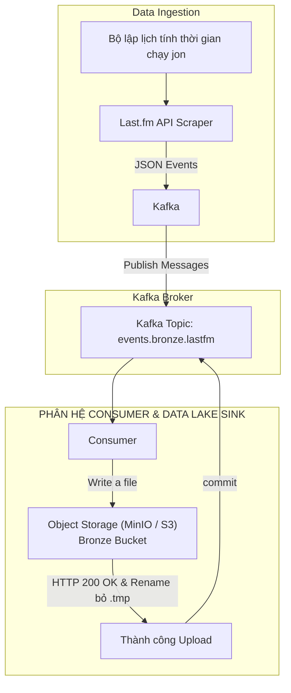
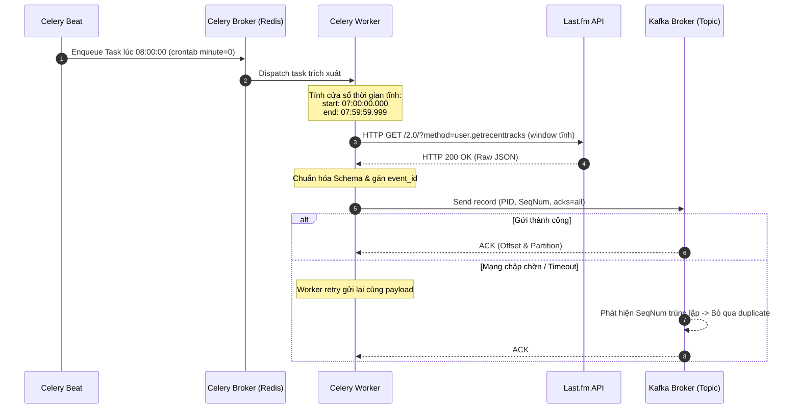
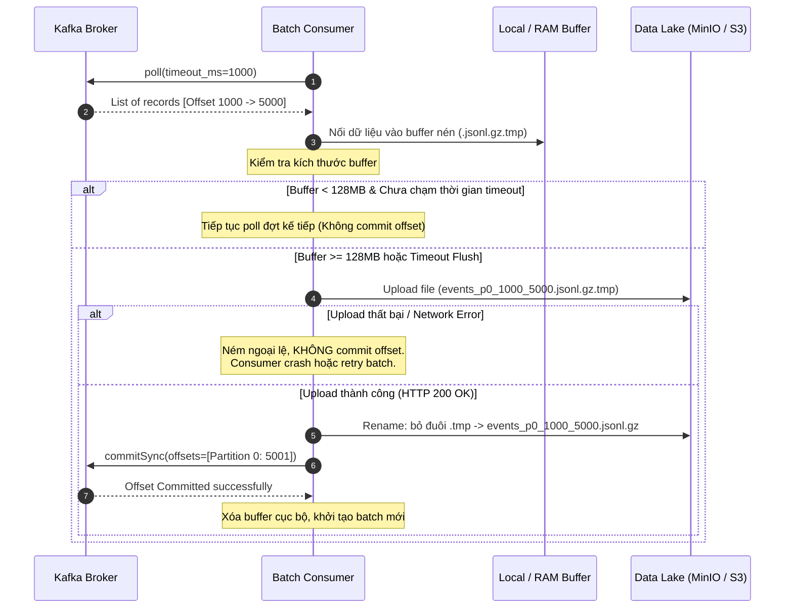

# TÀI LIỆU ĐẶC TẢ YÊU CẦU PHẦN MỀM (SRS)

## HỆ THỐNG INGESTION DỮ LIỆU BATCH

## 1. GIỚI THIỆU (INTRODUCTION)

### 1.1. Mục đích tài liệu (Purpose)

Tài liệu này đặc tả chi tiết kiến trúc và các yêu cầu chức năng, phi chức năng cho hệ thống thu thập dữ liệu (Ingestion Pipeline) phục vụ nền tảng Big Data Music Analytics. Hệ thống bao gồm 2 phân hệ cốt lõi:

1. **Producer Service**: Lập lịch định kỳ bằng Celery Beat, trích xuất dữ liệu nghe nhạc (listening events) từ Last.fm API và đẩy vào Apache Kafka đảm bảo tính lũy thừa (Idempotency).
2. **Consumer Service**: Tiến trình nạp dữ liệu nền liên tục, thực hiện cơ chế Micro-batching tối ưu dung lượng (128MB - 256MB), ghi nguyên tử (Atomic Write) lên Data Lake (MinIO/S3), quản lý offset thủ công và cam kết toàn vẹn dữ liệu từ tầng Bronze sang Silver.

### 1.2. Phạm vi hệ thống (Scope)

- **Thành phần liên quan**:
  - Celery Beat Scheduler & Celery Workers.
  - Apache Kafka Cluster (Broker & Controller).
  - Data Lake Ingestion Consumer.
  - Object Storage (MinIO / AWS S3).
  - Storage Layer: Tầng Bronze (Raw Data, JSON Lines nén Gzip) và Tầng Silver (Delta Lake / Apache Iceberg).
- **Mã nguồn liên quan trong dự án**:
  - Cấu hình hạ tầng container: [docker-compose.yml](file:///c:/Users/ADMIN/Desktop/MyProject/bigdata-music-analytics/docker-compose.yml)
  - Logic xử lý trích xuất hiện tại: [batch.py](file:///c:/Users/ADMIN/Desktop/MyProject/bigdata-music-analytics/src/batch/batch.py)

### 1.3. Định nghĩa & Thuật ngữ (Definitions & Acronyms)

| Thuật ngữ          | Định nghĩa đầy đủ                                                                                                                        |
| :----------------- | :--------------------------------------------------------------------------------------------------------------------------------------- |
| **SRS**            | Software Requirements Specification (Đặc tả yêu cầu phần mềm)                                                                            |
| **Idempotency**    | Tính lũy thừa: Thuộc tính mà một tác vụ khi thực hiện lặp lại nhiều lần với cùng tham số đầu vào vẫn mang lại kết quả duy nhất không đổi |
| **At-Least-Once**  | Ngữ nghĩa phân tán: Đảm bảo bản ghi luôn được xử lý ít nhất một lần, chấp nhận có thể lặp bản ghi khi có sự cố mạng                      |
| **Exactly-Once**   | Ngữ nghĩa phân tán: Đảm bảo bản ghi được xử lý và ghi nhận chính xác một lần duy nhất trong toàn hệ thống                                |
| **PID**            | Producer ID do Kafka Broker cấp phát để quản lý phiên và thứ tự gửi tin nhắn                                                             |
| **Micro-batching** | Kỹ thuật gom nhiều bản ghi nhỏ thành một batch lớn trước khi đẩy xuống tầng lưu trữ phân tán                                             |
| **Bronze Layer**   | Tầng dữ liệu thô (Raw Data Lake), giữ nguyên trạng dữ liệu nguồn                                                                         |
| **Silver Layer**   | Tầng dữ liệu đã làm sạch, chuẩn hóa kiểu dữ liệu và khử trùng lặp (Deduplicated Data)                                                    |

---

## 2. KIẾN TRÚC TỔNG THỂ HỆ THỐNG (SYSTEM ARCHITECTURE OVERVIEW)

### 2.1. Sơ đồ luồng dữ liệu End-to-End

---

## 3. ĐẶC TẢ YÊU CẦU CHỨC NĂNG (FUNCTIONAL REQUIREMENTS)

### PHÂN HỆ 1: PRODUCER - CELERY CRONJOB & TRÍCH XUẤT DỮ LIỆU

#### [FR-PROD-01] Lập lịch định kỳ

- **Mô tả**: Hệ thống sử dụng một bộ lập lịch để đẩy task trích xuất dữ liệu vào hàng đợi theo chu kỳ chính xác.
- **Quy chuẩn lịch chạy**:
  - Chu kỳ: Đúng vào phút thứ 0 của mỗi giờ (ví dụ: `08:00:00`, `09:00:00`, `10:00:00`).
- **Đầu ra**: Task message được đẩy vào Celery Queue chứa timestamp kích hoạt (`trigger_time`).
- **Công nghệ gợi ý**: Celery worker và Redis

#### [FR-PROD-02] Cơ chế tính toán cửa sổ thời gian

- **Mô tả**: Ngăn ngừa sai lệch dữ liệu khi task bị nghẽn queue hoặc phải chạy lại nhiều lần (retry). Worker không bao giờ lấy thời điểm mà nó thực thi job làm mốc.
- **Quy tắc tính toán**:
  - Lấy mốc giờ kích hoạt `T_trigger = YYYY-MM-DD HH:00:00.000`.
  - Cửa sổ thời gian truy vấn được xác định tĩnh:
    Ví dụ thời điểm bắt đầu chạy job là $$T_{trigger} = 08:00:00:00$$
    $$\text{start\_time} = T_{trigger} - 1 \text{ giờ} \quad (\text{ví dụ: } 07:00:00.000)$$
    $$\text{end\_time} = T_{trigger} - 1 \text{ mili-giây} \quad (\text{ví dụ: } 07:59:59.999)$$

    Lấy toàn bộ data trên trang web tại cửa sổ thời gian đó

#### [FR-PROD-03] Chuẩn hóa lược đồ sự kiện

- **Mô tả**: Dữ liệu từ Last.fm API phải được chuẩn hóa trước khi đẩy vào Kafka, trường chuẩn hóa đã được chốt và lấy trên docs của nhóm

#### [FR-PROD-04] Cấu hình Idempotent Kafka Producer

- **Mô tả**: Producer đẩy dữ liệu vào topic `events.bronze.lastfm` với cấu hình chống trùng lặp tại Broker.
- **Tham số cấu hình bắt buộc**:
  - `enable.idempotence = true`: Kafka tự động cấp Producer ID (PID) và gán `Sequence Number` tăng dần đơn điệu cho mỗi record trên từng partition.
  - `acks = all`: Broker chỉ xác nhận khi bản ghi đã được ghi thành công vào toàn bộ In-Sync Replicas (ISR).
  - `max.in.flight.requests.per.connection <= 5`: Giữ nguyên thứ tự tin nhắn ngay cả khi có retry.
  - `retries = 2147483647` (INT_MAX): Cho phép retry tối đa khi gặp lỗi tạm thời.
- **Cơ chế chống lặp**: Nếu lỗi mạng xảy ra sau khi Broker đã ghi dữ liệu nhưng ACK bị thất lạc, Worker gửi lại bản ghi, Broker sẽ kiểm tra Sequence Number và từ chối ghi đè (Deduplication ở cấp độ Topic Partition).

---

### PHÂN HỆ 2: CONSUMER

#### [FR-CONS-01] Quản lý Offset thủ công

- **Mô tả**: Consumer chạy nền liên tục ở trạng thái polling, hoặc có thể chạy một luồng Kafka Connect để polling idk để chốt sau.
- **Vòng đời cam kết**:
  1. Consumer đọc batch tin nhắn từ Kafka Topic `events.bronze.lastfm`.
  2. Ghi nối tiếp các bản ghi vào buffer cục bộ.
  3. Khi buffer vượt ngưỡng dung lượng, kích hoạt tiến trình upload lên Object Storage.
  4. **Chỉ khi và chỉ khi** nhận được phản hồi `HTTP 200 OK` (hoặc xác nhận upload thành công) từ Data Lake, Consumer mới gọi phương thức `commitSync()` để cập nhật offset đã xử lý lên Kafka Broker.

#### [FR-CONS-02] Cơ chế Gom cụm (Micro-Batching 128MB - 256MB)

- **Mô tả**: Giải quyết vấn đề "Small Files Problem" trên Data Lake, tối ưu hóa hiệu năng đọc của các công cụ tính toán phân tán.
- **Ngưỡng kích hoạt xả buffer (Flush Conditions)**:
  - **Ngưỡng dung lượng (Size Trigger)**: Dung lượng nén đạt từ **128 MB đến 256 MB**.
  - **Ngưỡng thời gian (Timeout Trigger)**: Nếu sau một khoảng thời gian quy định (ví dụ: 30 phút) mà dung lượng chưa đạt 128MB (do lưu lượng thấp ban đêm), hệ thống vẫn xả file để tránh tình trạng dữ liệu quá trễ.
- **Định dạng file nén**: JSON Lines nén Gzip (`.jsonl.gz`) hoặc Parquet với nén Snappy.

#### [FR-CONS-03] Cơ chế Ghi nguyên tử (Atomic Write Protocol)

- **Mô tả**: Đảm bảo không bao giờ xuất hiện file hỏng hoặc file dở dang trong Data Lake khi tiến trình Consumer bị crash đột ngột.
- **Quy trình thực hiện**:
  1. Tên file tạm thời bắt buộc có phần mở rộng `.tmp`:
     $$\text{Pattern: } \texttt{events\_p\{partition\}\_\{start\_offset\}\_\{end\_offset\}\_\{timestamp\}.jsonl.gz.tmp}$$
  2. Toàn bộ quá trình stream dữ liệu/upload diễn ra trên file `.tmp`.
  3. Sau khi Storage xác nhận upload hoàn tất 100%, thực hiện thao tác **Atomic Rename / Copy-Delete** để bỏ đuôi `.tmp`, chuyển thành file chính thức:
     $$\texttt{events\_p\{partition\}\_\{start\_offset\}\_\{end\_offset\}\_\{timestamp\}.jsonl.gz}$$
  4. Bất kỳ tiến trình đọc nào ở tầng sau luôn bỏ qua các file có tiền tố hoặc hậu tố `.tmp`.

---

## 4. BIỂU ĐỒ TUẦN TỰ HỆ THỐNG (SEQUENCE DIAGRAMS)

### 4.1. Vòng đời xử lý của Producer

### 4.2. Vòng đời xử lý của Consumer (Micro-batching & Commit)

---

## 5. YÊU CẦU PHI CHỨC NĂNG (NON-FUNCTIONAL REQUIREMENTS)

### 5.1. Độ tin cậy & Toàn vẹn dữ liệu

- **NFR-REL-01**: Tỷ lệ mất mát dữ liệu trong toàn bộ pipeline Ingestion phải bằng **0%**.
- **NFR-REL-02**: Mọi bản ghi lỗi không thể parse schema (malformed records) phải được định tuyến sang Dead Letter Queue (DLQ) trên Kafka hoặc bucket `bronze/dead_letter/` để phân tích sau, không làm sập tiến trình.

### 5.2. Hiệu năng & Khả năng mở rộng

- **NFR-PERF-01**: Kích thước file nạp vào Data Lake phải duy trì ổn định ở khoảng **128MB - 256MB**, kích thước này tương thích tối ưu với kích thước Block mặc định của HDFS/Parquet Split, giảm thiểu metadata overhead cho Spark Driver.
- **NFR-PERF-02**: Consumer phải hỗ trợ scaling theo cơ chế Kafka Consumer Group. Khi tăng số lượng partition của topic, hệ thống có thể tăng số lượng consumer instance tương ứng mà không cần sửa đổi mã nguồn.

### 5.3. Khả năng chịu lỗi & Tự phục hồi

- **NFR-FT-01**: Khi Kafka Broker tạm thời mất kết nối, Producer phải lưu tạm tin nhắn trong memory buffer cục bộ có giới hạn (bounded buffer) và thực hiện lũy thừa lùi (exponential backoff) trước khi thử lại.
- **NFR-FT-02**: Khi Consumer bị tắt cưỡng bức (`kill -9` hoặc Node Eviction), các file `.tmp` trên Data Lake sẽ được dọn dẹp định kỳ bởi một cronjob dọn dẹp độc lập (Garbage Collector Job) sau 24 giờ.

---
