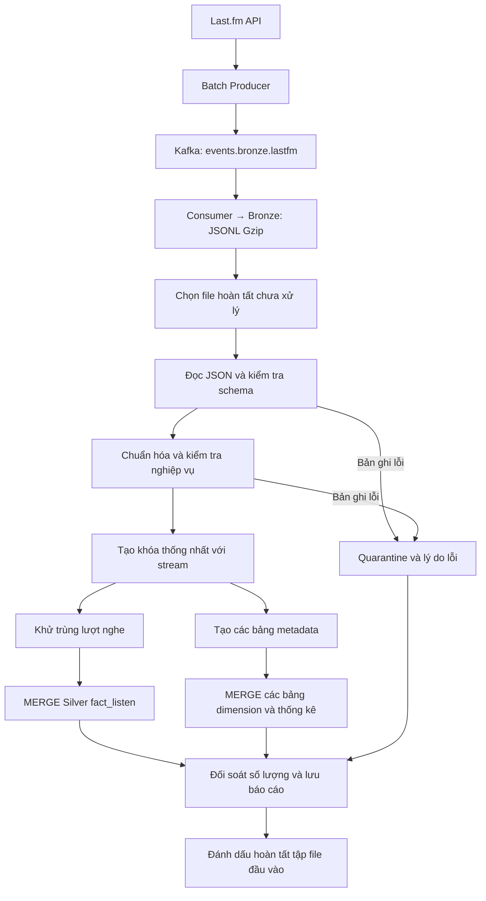

# PIPELINE LÀM SẠCH DỮ LIỆU BATCH: BRONZE → SILVER

Tài liệu mô tả cách chuyển dữ liệu Last.fm đã thu thập thành dữ liệu sạch phục vụ phân tích trong dự án Big Data Music Analytics. Đầu ra chính là bảng `fact_listen`, trong đó mỗi dòng đại diện cho một lượt nghe, cùng các bảng thông tin người dùng, bài hát, nghệ sĩ và album.

**Trạng thái:** đây là thiết kế để triển khai job làm sạch. Repository đã có producer, consumer ghi Bronze và các hàm chuẩn hóa dùng trong stream; job batch Bronze → Silver được mô tả dưới đây chưa được triển khai. Đường dẫn lưu trữ và lịch chạy ở tầng Silver là đề xuất.

## 1. Phạm vi và thành phần sử dụng

| Thành phần | Vai trò | Nguồn tham chiếu |
|---|---|---|
| Batch producer | Thu thập và chuẩn hóa cấu trúc JSON đầu vào | [schema.py](../batch/producer/schema.py) |
| Batch consumer | Gom bản ghi và lưu file `.jsonl.gz` lên Bronze | [kafka_consumer.py](../batch/consumer/kafka_consumer.py) |
| Job làm sạch cần bổ sung | Kiểm tra, chuyển kiểu, tạo khóa và khử trùng | Pipeline trong tài liệu này |
| Hàm chuẩn hóa và tạo ID | Thống nhất khóa thực thể và lượt nghe với stream | [ids.py](../stream/common/ids.py) |
| Hàm tạo dòng lượt nghe | Tham chiếu cách ánh xạ sang `fact_listen` | [fact_listen.py](../stream/common/fact_listen.py) |
| Hợp đồng dữ liệu đầu ra | Tên trường, kiểu dữ liệu và khả năng nhận `null` | [fields.csv](fields.csv) |

Giữ nguyên dữ liệu Bronze để đối chiếu và chạy lại. Làm sạch tạo đầu ra mới ở Silver; dữ liệu lỗi được lưu riêng kèm nguyên nhân. Tài liệu ingestion hiện tại nằm tại [batch_pipeline.md](batch_pipeline.md).

## 2. Luồng xử lý tổng thể



Metadata được lấy từ các bản ghi hợp lệ trước khi khử trùng lượt nghe, để giữ được những lần thu thập bổ sung thông tin cho cùng một event.

## 3. Đầu vào và cách chọn file

| Nguồn | Đường dẫn | Cách sử dụng |
|---|---|---|
| File producer trên máy | `data/producer/runs/<run_id>/events.jsonl` | Dùng để phát triển và kiểm tra quy tắc làm sạch |
| Bronze trên MinIO | `s3a://bronze/events/*.jsonl.gz` | Đầu vào vận hành, theo bucket và prefix mặc định |
| Response API gốc | `data/raw/<method>.jsonl` | Dùng bộ ánh xạ riêng nếu cần bổ sung metadata |

Một dòng trong `events.jsonl` là một event gồm các nhóm `scrobble_event`, `user_profile`, `track_metadata`, `artist_metadata`, `album_metadata`, cùng các trường quản lý như `schema_version`, `event_id`, `source`, `ingested_at`.

Một dòng trong `data/raw/*.jsonl` là gói response có `method`, `params`, `fetched_at`, `response`. Ví dụ, thông tin bài nằm trong `response.track` của `track.getInfo`. Các danh sách top bài hoặc nghệ sĩ tương tự không được biến thành lượt nghe trong `fact_listen`.

Quy tắc chọn file:

- Chỉ đọc file `.jsonl.gz` đã hoàn tất; bỏ qua file `.tmp` và thư mục `dead_letter` của ingestion.
- Với file producer trên máy, kiểm tra `summary.json`: chỉ dùng run có trạng thái `extracted`, `published` hoặc `publish_failed`. Hai trạng thái `extracting`, `extract_failed` chưa bảo đảm thu thập hoàn tất.
- Lưu danh sách file đầu vào cố định khi bắt đầu job. File xuất hiện sau đó được xử lý ở lượt tiếp theo.
- Theo dõi file bằng URI và phiên bản object; khi không có version ID, dùng ETag và kích thước để nhận diện phiên bản. Không coi ETag luôn là MD5 của nội dung.
- Chọn file chưa hoàn tất trong sổ theo dõi xử lý, kể cả file chứa lượt nghe cũ. Sổ theo dõi dùng khóa `(pipeline_version, source_uri, object_version)`; chỉ coi file đã hoàn tất khi run liên quan có trạng thái `succeeded`. Thời điểm nghe không phải điều kiện để bỏ qua file.
- Tách dữ liệu `source=demo` sang môi trường thử nghiệm; nguồn chưa được hỗ trợ cần được ghi nhận riêng.

Spark đọc JSON Lines theo nguyên tắc mỗi dòng là một JSON object. Khi triển khai, khai báo schema đầu vào rõ ràng và giữ nội dung bản ghi không đọc được để đưa vào quarantine. [Tài liệu Spark JSON](https://spark.apache.org/docs/latest/sql-data-sources-json.html)

## 4. Kiểm tra và chuẩn hóa dữ liệu

### 4.1. Kiểm tra trước khi ánh xạ

Consumer hiện kiểm tra cấu trúc tối thiểu. Job Silver cần kiểm tra hợp đồng `schema_version=1.0` trong [schema.py](../batch/producer/schema.py), rồi kiểm tra thêm ý nghĩa của các giá trị.

| Điều kiện | Xử lý |
|---|---|
| Dòng rỗng, JSON lỗi hoặc giá trị gốc không phải object | Quarantine với mã `INVALID_JSON` |
| Schema không hợp lệ hoặc phiên bản chưa hỗ trợ | Quarantine với mã `INVALID_SCHEMA` hoặc `UNSUPPORTED_SCHEMA_VERSION` |
| Username, tên bài hoặc tên nghệ sĩ rỗng sau chuẩn hóa | Quarantine với mã `MISSING_REQUIRED_FIELD` |
| `date.uts` không chuyển được thành số nguyên không âm hoặc nằm ngoài miền timestamp hỗ trợ | Quarantine với mã `INVALID_LISTENED_AT` |
| `ingested_at` không đọc được hoặc thiếu múi giờ | Quarantine với mã `INVALID_INGESTED_AT` |
| Thời điểm nghe lớn hơn `ingested_at` quá mức cho phép | Quarantine với mã `FUTURE_EVENT`; ngưỡng đề xuất là 300 giây và cần cấu hình được |
| Lượt nghe đến muộn nhưng có thời gian hợp lệ | Giữ bản ghi, ghi vào ngày nghe tương ứng |
| Album, MBID hoặc metadata không có | Giữ lượt nghe và chuẩn hóa trường thiếu |
| `metadata_errors` không rỗng | Giữ lượt nghe hợp lệ, ghi nhận chất lượng metadata |
| File Gzip hỏng hoặc không đọc hết được | Đánh dấu lỗi file, không xác nhận file đã xử lý; retry hoặc khôi phục file |

Kiểm tra và chuyển số cần chịu được giá trị sai: dữ liệu tùy chọn không hợp lệ trở thành `null` kèm cờ chất lượng; dữ liệu bắt buộc không hợp lệ đi vào quarantine. Giá trị kiểu `long` phải nằm trong miền số nguyên 64 bit.

### 4.2. Quy tắc chuẩn hóa dùng chung

- **Tên hiển thị:** bỏ khoảng trắng đầu và cuối; giữ nguyên dấu, cách viết hoa và thông tin phiên bản như `Live`, `Remastered`.
- **Tên dùng để so khớp:** dùng `normalize_text()` để chuẩn hóa Unicode NFKC, `casefold()` và gộp khoảng trắng. Giữ dấu tiếng Việt.
- **Username:** dùng `user_key()` để bỏ khoảng trắng đầu/cuối và chuyển chữ thường, giống stream.
- **MBID:** dùng `normalize_mbid()`; thiếu hoặc sai định dạng UUID thì nhận `null`.
- **Duration:** dữ liệu `track_metadata.duration` được ánh xạ theo đơn vị mili giây; số không dương hoặc không hợp lệ nhận `null`.
- **Các bộ đếm:** `playcount`, `listeners`, `userplaycount` hợp lệ khi là số nguyên không âm. Số 0 có ý nghĩa; giá trị chưa biết nhận `null`.
- **Tags:** lấy thuộc tính `name`, bỏ tên sai kiểu hoặc rỗng, chuẩn hóa, khử trùng và giữ thứ tự xuất hiện. `fact_listen` giữ tối đa 5 tag, phù hợp hàm hiện có. Ưu tiên tags của track; nếu không có, dùng tags của artist và ghi rõ `tag_source`.
- **Loved:** `"1"` thành `true`, `"0"` thành `false`. Với `null`, dùng `false` để khớp hợp đồng boolean hiện tại và ghi cờ `LOVED_MISSING` trong audit; giá trị này không chứng minh người dùng đã bỏ yêu thích.
- **Thời gian:** lưu Unix giây và tính ngày, giờ theo UTC. `crawled_at` lấy từ `ingested_at`, không lấy thời gian chạy lại job. `processed_at` trong audit lưu thời điểm xử lý.

Thiết lập `spark.sql.session.timeZone=UTC` cho job Spark. Khi tính `dow`, bảo đảm kết quả theo ISO: thứ Hai = 1, Chủ nhật = 7; kiểm tra riêng quy ước của hàm Spark được sử dụng.

### 4.3. Ánh xạ đầy đủ bảng `fact_listen`

| Trường đầu ra | Kiểu | Được `null` | Nguồn và phép chuyển |
|---|---|---|---|
| `event_id` | string | Không | `make_event_id(user_id, listened_at, track_id)` |
| `user_id` | string | Không | `user_key(user_profile.name)` |
| `listened_at` | long | Không | Chuyển `scrobble_event.date.uts` thành Unix giây |
| `listened_date` | string | Không | Ngày UTC dạng `YYYY-MM-DD` |
| `dow` | int | Không | Thứ theo ISO, từ 1 đến 7 |
| `hour` | int | Không | Giờ UTC, từ 0 đến 23 |
| `track_id` | string | Không | `make_track_id(artist_norm, track_norm)` |
| `track_name` | string | Không | `scrobble_event.name`, bỏ khoảng trắng đầu/cuối |
| `track_norm` | string | Không | `normalize_text(track_name)` |
| `track_mbid` | string | Có | `normalize_mbid(scrobble_event.mbid)` |
| `artist_id` | string | Không | `make_artist_id(artist_norm)` |
| `artist_name` | string | Không | `scrobble_event.artist.name`, bỏ khoảng trắng đầu/cuối |
| `artist_norm` | string | Không | `normalize_text(artist_name)` |
| `artist_mbid` | string | Có | `normalize_mbid(scrobble_event.artist.mbid)` |
| `album_id` | string | Có | `make_album_id(artist_norm, album_norm)` khi có tên album |
| `album_name` | string | Có | `scrobble_event.album.name`; rỗng thành `null` |
| `album_mbid` | string | Có | MBID hợp lệ khi có tên album; còn lại nhận `null` |
| `loved` | boolean | Không | Chuyển theo quy tắc loved ở trên |
| `duration_ms` | long | Có | Số nguyên dương từ `track_metadata.duration` |
| `tags` | array<string> | Không | Danh sách tối đa 5 tag đã chuẩn hóa; thiếu nhận `[]` |
| `tag_source` | string | Có | `track`, `artist` hoặc `null` khi không có tag |
| `crawled_at` | long | Không | Unix giây từ `ingested_at` |

Trường truy vết và cờ chất lượng được lưu ở bảng audit riêng, giữ bảng nghiệp vụ theo [fields.csv](fields.csv).

### 4.4. Tái sử dụng hàm ánh xạ hiện có

`to_fact_listen()` đang đọc username từ trường `user`, trong khi batch lưu tại `user_profile.name`. Đoạn Python dưới đây minh họa phần chuyển đổi cho **một event đã vượt qua bước kiểm tra**, không phải job Spark hoàn chỉnh:

```python
from datetime import datetime

from stream.common.fact_listen import to_fact_listen
from stream.common.ids import normalize_text


def map_batch_event(event):
    ingested = datetime.fromisoformat(event["ingested_at"].replace("Z", "+00:00"))
    if ingested.tzinfo is None:
        raise ValueError("ingested_at thiếu múi giờ")

    tags = []
    tag_source = None
    candidates = (
        ("track", event["track_metadata"]["toptags"]["tag"]),
        ("artist", event["artist_metadata"]["tags"]["tag"]),
    )
    for source, items in candidates:
        for item in items:
            raw_name = item.get("name")
            if not isinstance(raw_name, str):
                continue
            name = normalize_text(raw_name)
            if name and name not in tags:
                tags.append(name)
        if tags:
            tag_source = source
            break

    adapted = {**event, "user": event["user_profile"]["name"]}
    return to_fact_listen(
        adapted,
        tags=tags[:5],
        tag_source=tag_source,
        duration_ms=event["track_metadata"]["duration"],
        now=int(ingested.timestamp()),
    )
```

Hàm này không tạo audit, quarantine hoặc kiểm tra đầy đủ schema. Khi triển khai trên Spark, xử lý trên executor và bảo đảm logic cho cùng kết quả với hàm tham chiếu; không gom toàn bộ dữ liệu về driver.

## 5. Khóa dữ liệu và khử trùng

### 5.1. Thống nhất ID với stream

Producer batch hiện tạo `event_id` dạng `lastfm:<sha256>` từ username, timestamp, tên nghệ sĩ, bài và album. Stream sử dụng công thức khác dựa trên `user_id`, thời điểm nghe và `track_id`.

Vì vậy, giữ ID đầu vào trong audit với tên `source_event_id`, rồi tạo lại khóa Silver bằng các hàm của [ids.py](../stream/common/ids.py):

| Khóa | Hàm sử dụng |
|---|---|
| Người dùng | `user_key(username)` |
| Nghệ sĩ | `make_artist_id(artist_norm)` |
| Bài hát | `make_track_id(artist_norm, track_norm)` |
| Album | `make_album_id(artist_norm, album_norm)` |
| Lượt nghe | `make_event_id(user_id, listened_at, track_id)` |

Khóa thực thể dựa trên tên chuẩn hóa, không phụ thuộc việc MBID có được trả về hay không. Nếu viết lại bằng biểu thức Spark, phải giữ nguyên cách mã hóa UTF-8, ký tự phân cách và độ dài hash của mã tham chiếu.

Hai lần nghe cùng bài ở hai thời điểm khác nhau là hai event. API không cung cấp ID riêng cho từng scrobble trong response này, nên cùng user, bài và giây nghe vẫn có thể bị gộp theo quy ước định danh; audit giữ thông tin nguồn để kiểm tra trường hợp đó.

### 5.2. Khử trùng trong batch và giữa các lần chạy

1. Tạo `event_id` Silver sau chuẩn hóa.
2. Ghi mọi bản hợp lệ vào bảng lịch sử listen_versions (append-only, khóa (event_id, source_record_id)), kể cả các bản trùng. Không xóa hoặc ghi đè bản nào trong bảng này.
3. Trong mỗi nhóm cùng ID, chọn bản có ingested_at mới nhất làm bản đại diện để chèn vào fact_listen (tiêu chí phân xử như cũ); các bản còn lại có is_selected=false và trạng thái audit DUPLICATE_IN_BATCH.
4. MERGE vào fact_listen chỉ chèn event chưa có. Khi event đã tồn tại từ lần chạy trước, dòng fact giữ nguyên; phiên bản mới vẫn được lưu ở listen_versions. Vì vậy fact_listen phản ánh bản được ghi đầu tiên, còn lịch sử đầy đủ nằm ở bảng phiên bản.

Thiết kế ban đầu dùng `MERGE` chỉ chèn event chưa có. Khi ID đã tồn tại, giữ nguyên dòng lượt nghe; metadata mới được cập nhật vào các bảng dimension. Cách này giữ ổn định số lượt nghe và snapshot metadata đã gắn với từng dòng fact.

Ví dụ SQL sau chỉ áp dụng khi bảng Delta đã được tạo, view `clean_events` đúng schema và đã khử trùng trong batch:

```sql
MERGE INTO silver.fact_listen AS target
USING clean_events AS source
ON target.event_id = source.event_id
WHEN NOT MATCHED THEN INSERT *;
```

`MERGE` không tự khử trùng các dòng trùng nhau trong tập nguồn. Cần thực hiện cả bước khử trùng đầu vào và bước so khớp với bảng đích. [Tài liệu Delta Lake](https://docs.delta.io/delta-update/#data-deduplication-when-writing-into-delta-tables)

    
## 6. Các bảng metadata

| Bảng | Khóa | Nguồn và quy tắc chính |
|---|---|---|
| `dim_user` | `user_id` | Lấy từ `user_profile`; parse các bộ đếm và `registered.unixtime` khi hợp lệ |
| `dim_track` | `track_id` | Tên và MBID từ scrobble; duration, listeners, playcount, tags từ `track_metadata`; URL ảnh từ ảnh hợp lệ trong scrobble |
| `dim_artist` | `artist_id` | Tên, MBID từ scrobble; tags và similar từ `artist_metadata`; tạo ID cho nghệ sĩ tương tự bằng cùng hàm chuẩn hóa |
| `dim_album` | `album_id` | Chỉ tạo khi có tên album; playcount từ `album_metadata`; chỉ tính `n_tracks` khi danh sách track được xác nhận đã lấy thành công |
| `user_item_stats` | `(user_id, item_type, item_id)` | Snapshot mới nhất của `userplaycount`; `item_type` là `track`, `artist` hoặc `album` |

Các quy tắc cần giữ:

- Producer hiện chỉ giữ `artist_metadata.stats.userplaycount`; chưa giữ `listeners` và `playcount` tổng của artist. Hai cột tương ứng trong `dim_artist` nhận `null` đến khi có nguồn bổ sung.
- Danh sách album tracks rỗng có thể do không lấy được metadata. Khi chưa xác định được, `n_tracks=null`; không tự coi là album có 0 bài.
- Chỉ tạo dòng `user_item_stats` khi `userplaycount` hợp lệ. Giá trị thiếu không được đổi thành 0 vì cột này không cho phép `null`.
- Một `track_id` có thể xuất hiện trong nhiều album. `fact_listen.album_id` ghi album của lượt nghe; `dim_track.album_id` là album đại diện theo snapshot được chọn, không diễn tả toàn bộ quan hệ track–album.
- Chọn một snapshot cho mỗi khóa trước khi `MERGE`. Chỉ cập nhật snapshot khi `crawled_at` mới hơn bản đang lưu; khi bằng nhau, giữ bản đích. Dữ liệu đến muộn không được ghi lùi snapshot mới.
- Có thể giữ giá trị tùy chọn hợp lệ từ snapshot cũ khi nguồn mới thiếu, nhưng phải ghi nguồn gốc phần giữ lại trong audit. `crawled_at` của dimension khi đó thể hiện lần cập nhật bản ghi, không phải tuổi của mọi thuộc tính.
- `playcount`, `listeners`, `userplaycount` là số liệu tại thời điểm thu thập. Tổng lượt nghe trong tập dữ liệu phải tính bằng cách đếm các event hợp lệ, không cộng các snapshot này.

## 7. Lưu trữ, quarantine và khả năng chạy lại

Đề xuất lưu các bảng nghiệp vụ bằng Delta Lake trên MinIO. Việc dùng Spark hiện có cho stream không đồng nghĩa S3A và Delta đã được cấu hình; cần chuẩn bị connector tương thích với Spark/Hadoop thực tế, thông tin truy cập từ môi trường và bucket đích trước khi triển khai job.

```text
bronze/
  events/                       # Dữ liệu đầu vào do consumer ghi

silver/
  fact_listen/                  # Các bảng Delta cần tạo
  dim_user/
  dim_track/
  dim_artist/
  dim_album/
  user_item_stats/

quality/
  quarantine/                   # Bản ghi lỗi và nguyên nhân
  record_audit/                 # Liên hệ nguồn → event, cờ chất lượng
  pipeline_runs/                # Báo cáo, trạng thái và phiên bản bảng
  processed_files/              # Sổ theo dõi file đã xử lý
```

Ban đầu có thể giữ bảng nhỏ không phân vùng. Khi dung lượng đủ lớn, cân nhắc phân vùng `fact_listen` theo `listened_date` và gộp file nhỏ; tránh phân vùng theo từng user.

Mỗi bản ghi quarantine hoặc audit cần có `source_record_id`, `source_uri`, phiên bản file, vị trí dòng, `source_event_id` nếu có, `event_id` Silver nếu tạo được, `pipeline_version`, `run_id`, `processed_at`, trạng thái và danh sách lý do. Quarantine giữ thêm nội dung gốc; với dòng không phải UTF-8 hợp lệ, giữ bytes bằng cách mã hóa có thể khôi phục.

`source_record_id` phải tái tạo được từ URI, phiên bản file và vị trí dòng. Khi retry, ghi audit/quarantine theo khóa `(pipeline_version, source_record_id)` để không nhân bản bản ghi chất lượng. Các lần thực thi được lưu riêng trong `pipeline_runs`.

Quy trình hoàn tất một lượt job:

1. Giữ khóa để chỉ một job ghi cùng bộ bảng Silver trong phiên bản triển khai đầu tiên.
2. Tạo `run_id`, lưu danh sách file và phiên bản pipeline; chuyển trạng thái run sang `running`.
3. Kiểm tra, chuẩn hóa, tạo các tập dữ liệu và ghi quarantine/audit.
4. Khử trùng rồi `MERGE` các bảng nghiệp vụ.
5. Đối soát số lượng, lưu báo cáo và phiên bản bảng sau ghi.
6. Đánh dấu tập file hoàn tất và trạng thái run `succeeded` sau khi mọi đầu ra bắt buộc đã được ghi thành công.

Nếu job lỗi giữa chừng, không xác nhận toàn bộ tập file đã hoàn tất. Lượt retry có thể đọc lại chúng: `MERGE` bảo vệ số lượt nghe, khóa audit bảo vệ dữ liệu chất lượng khỏi bị nhân bản. File chỉ chứa các dòng bị loại vẫn được coi là xử lý xong nếu mọi dòng đã được ghi nhận và đối soát thành công.

Giao dịch Delta có phạm vi từng bảng; các bảng trong pipeline không được commit đồng thời như một giao dịch chung. Chỉ kích hoạt bước tổng hợp tiếp theo sau khi run `succeeded`. Nếu cần đọc nhất quán giữa nhiều bảng, sử dụng các phiên bản bảng được ghi trong báo cáo của run thành công.

Đề xuất chạy job mỗi giờ vào phút thứ 10. Mỗi lượt xử lý tất cả file hoàn tất chưa được xác nhận; file consumer chưa flush hoặc vừa xuất hiện sẽ được nhận ở lượt sau. Không giới hạn đầu vào theo đúng một giờ nghe, nhờ đó dữ liệu đến muộn vẫn được xử lý.

## 8. Báo cáo chất lượng và tiêu chí nghiệm thu

| Chỉ số | Ý nghĩa |
|---|---|
| `input_records` | Tổng dòng đầu vào của các file đọc hoàn chỉnh |
| `excluded_records` | Bản ghi có nguồn thuộc nhóm chủ động tách khỏi dữ liệu thật |
| `rejected_records` | Bản ghi lỗi đã ghi vào quarantine |
| `valid_records` | Bản ghi hợp lệ trước khử trùng |
| `duplicate_in_batch` | Số bản sao bị loại trong tập đầu vào |
| `unique_valid_records` | Số event hợp lệ sau khử trùng trong batch |
| `already_present_records` | Số event đã có trong Silver ngay trước lần merge này |
| `inserted_records` | Số event mới được chèn trong lần thực thi này |
| `metadata_incomplete_records` | Bản ghi thiếu hoặc lỗi metadata; đây là chỉ số phụ, có thể giao với các nhóm trên |
| `failed_files` | File không đọc hoặc xử lý hoàn tất được |

Các phương trình đối soát áp dụng cho tập file đã đọc hoàn chỉnh:

```text
input_records = excluded_records + rejected_records + valid_records
valid_records = duplicate_in_batch + unique_valid_records
unique_valid_records = already_present_records + inserted_records
```

Khi retry sau lần ghi dở, `inserted_records` có thể nhỏ hơn lần trước vì một số event đã tồn tại; tổng số event duy nhất trong Silver phải đúng. Số dòng của file đọc dở được báo cáo riêng, không dùng để xác nhận các phương trình trên hoặc hoàn tất tập file.

| Tình huống kiểm tra | Kết quả cần đạt |
|---|---|
| Chạy lại cùng tập file và phiên bản pipeline | Không thêm lượt nghe hoặc audit trùng |
| Cùng bài, cùng user, hai timestamp khác nhau | Giữ hai lượt nghe |
| Hai bản sao cùng event nằm ở hai file | Chỉ một dòng fact; truy được cả hai nguồn |
| Tên khác hoa/thường hoặc khoảng trắng | Tạo khóa theo cùng quy tắc của stream |
| Thiếu album hoặc MBID | Giữ lượt nghe, trường tùy chọn nhận `null` |
| Thiếu duration hoặc duration bằng 0 | `duration_ms=null`, không suy diễn thời lượng nghe thực tế |
| Thiếu loved | `loved=false` và có cờ `LOVED_MISSING` |
| Timestamp hoặc JSON không hợp lệ | Có quarantine và lý do; các dòng hợp lệ còn lại vẫn được xử lý |
| Event cũ đến muộn | Ghi đúng ngày nghe, không ghi đè metadata mới bằng snapshot cũ |
| Thời điểm gần nửa đêm hoặc ngày Chủ nhật | Ngày, giờ UTC và `dow` ISO chính xác |
| Consumer đang upload file `.tmp` | File chưa được chọn làm đầu vào |
| Job lỗi sau khi ghi fact nhưng trước khi ghi dimension | Retry hoàn tất các bảng mà không tăng sai số lượt nghe |
| Metadata artist thiếu bộ đếm tổng | `dim_artist.listeners` và `playcount` nhận `null` |

## 9. Thứ tự triển khai đề xuất

1. Viết bộ kiểm tra và ánh xạ event; chạy trên các file producer đã hoàn tất trên máy.
2. Đối chiếu đủ trường của `fact_listen` với `fields.csv`, kiểm tra ID bằng hàm stream và kiểm tra các trường hợp ở mục 8.
3. Bổ sung đọc Bronze qua S3A, chọn file hoàn tất và lưu danh sách đầu vào.
4. Cấu hình Delta, tạo bảng và triển khai khử trùng cùng `MERGE` cho fact.
5. Bổ sung các bảng dimension, thống kê và xử lý các trường chưa có nguồn.
6. Hoàn thiện quarantine, audit, báo cáo và sổ theo dõi file; kiểm tra retry sau lỗi từng bước.
7. Đưa job vào lịch chạy và chỉ cho phép tác vụ tổng hợp chạy sau lượt xử lý thành công.

Các bước trên là công việc triển khai tiếp theo từ bản thiết kế này; hiện chưa có lệnh CLI Bronze → Silver để chạy trực tiếp trong repository.
