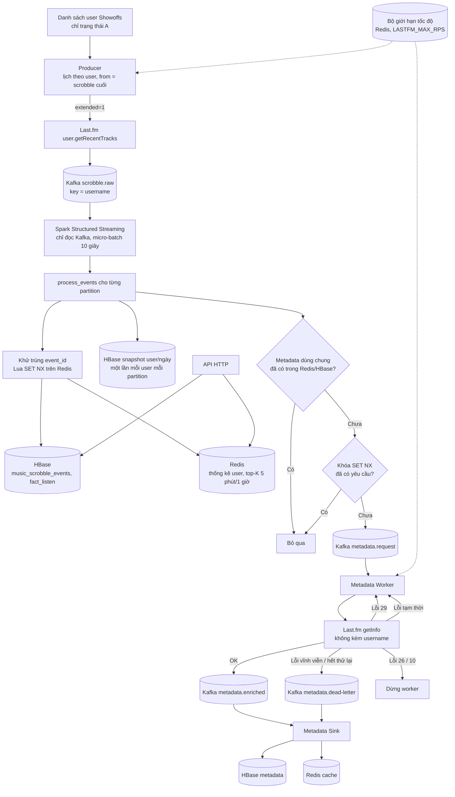

# Luồng stream

## Thành phần

| Thành phần | File | Việc làm |
|---|---|---|
| Producer | `stream/producer/produce_scrobbles.py` | Poll user theo lịch riêng (60 → 900 giây), chỉ lấy scrobble mới (`from`), gửi vào Kafka, lưu checkpoint |
| Replay | `stream/producer/replay_scrobbles.py` | Phát lại log JSONL với tốc độ tuỳ chọn để demo và đo tải |
| Spark job | `stream/processing/spark_speed_layer.py` | Đọc Kafka, gọi `process_events` cho từng partition |
| Lõi xử lý | `stream/processing/pipeline.py` | Toàn bộ nghiệp vụ speed layer (test được không cần Spark) |
| Redis | `stream/processing/realtime_store.py` | Lua khử trùng và cập nhật thống kê; top-K theo cửa sổ |
| Worker | `stream/metadata/metadata_worker.py` | Gọi `getInfo`, xử lý lỗi theo loại |
| Sink | `stream/metadata/metadata_sink.py` | Ghi kết quả metadata vào HBase và Redis |
| API | `stream/api/server.py` | Đọc Redis và HBase |

## Điều cần biết khi đọc số liệu

- **Không có watermark.** Khử trùng bằng Redis; cửa sổ 5 phút và 1 giờ là bucket cộng dồn theo thời gian nghe, không phải cửa sổ stateful của Spark.
- **At-least-once.** Chạy lại micro-batch không đếm dôi nhờ khóa khử trùng (TTL 7 ngày); nếu quá TTL một event lặp lại sẽ đếm lại.
- **Độ trễ end-to-end** gồm: Last.fm chỉ ghi scrobble sau khi nghe ít nhất nửa bài (hoặc 4 phút), cộng chu kỳ poll của user (≥ 60 giây), cộng micro-batch Spark (10 giây). Con số trên Spark UI chỉ là phần cuối.
- **Thời gian theo UTC.** `fact_listen.dow` theo ISO (1 = Thứ hai … 7 = Chủ nhật).

## Bảng HBase

| Bảng | Nội dung |
|---|---|
| `music_scrobble_events` | event thô, row key `salt#user#đảo-thời-gian#event_id` (mới nhất trước) |
| `fact_listen` | dòng phẳng khớp bảng trường nhóm đã chốt (`docs/fields.csv`), cùng row key |
| `music_late_events` | event đến muộn |
| `music_user_metrics_realtime` | snapshot thống kê theo user/ngày |
| `music_user_profile`, `music_track_metadata`, `music_artist_metadata`, `music_album_metadata` | metadata dùng chung |
| `music_user_*_stats` | `userplaycount`, chỉ có khi chạy `--per-user-stats` |
| `music_metadata_failures` | dead-letter |
