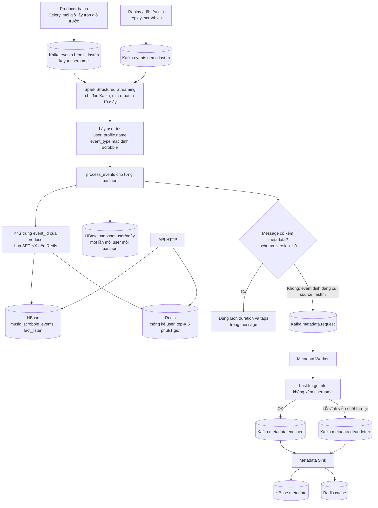

# Luồng stream

Speed layer đọc message của **producer batch** (Celery, `batch/producer/`), là nguồn dữ liệu duy nhất của project. Hợp đồng giữa hai nhóm (topic, schema, khóa, ánh xạ `fact_listen`): `docs/architecture.md`.

Batch consumer chỉ đọc `events.bronze.lastfm`, nên dữ liệu giả ở `events.demo.lastfm` không lẫn vào tầng Bronze của batch.

## Thành phần

| Thành phần | File | Việc làm |
|---|---|---|
| Đọc message batch | `stream/common/bronze_event.py` | Nhận biết message batch, lấy username, duration, tags, `ingested_at` |
| Spark job | `stream/processing/spark_speed_layer.py` | Đọc `events.bronze.lastfm` và `events.demo.lastfm`, gọi `process_events` cho từng partition |
| Lõi xử lý | `stream/processing/pipeline.py` | Toàn bộ nghiệp vụ speed layer (test được không cần Spark) |
| Redis | `stream/processing/realtime_store.py` | Lua khử trùng và cập nhật thống kê; top-K theo cửa sổ |
| `fact_listen` | `stream/common/fact_listen.py` | Ánh xạ message sang dòng phẳng, theo `docs/architecture.md` mục 3.5 |
| Replay | `stream/producer/replay_scrobbles.py` | Phát lại log JSONL vào `events.demo.lastfm` để demo và đo tải |
| Worker, Sink | `stream/metadata/` | Chỉ còn dùng cho event định dạng cũ có `source=lastfm` |
| Producer cũ | `stream/producer/produce_scrobbles.py` | **Ngừng dùng** (profile `legacy`); ghi vào `scrobble.raw`, Spark không đọc topic này nữa |
| API | `stream/api/server.py` | Đọc Redis và HBase |

## Điều cần biết khi đọc số liệu

- **Không có watermark.** Khử trùng bằng Redis; cửa sổ 5 phút và 1 giờ là bucket cộng dồn theo thời gian nghe, không phải cửa sổ stateful của Spark.
- **At-least-once.** Chạy lại micro-batch hay batch consumer giao lại message không đếm dôi nhờ khóa khử trùng theo `event_id` (TTL 7 ngày); quá TTL thì một event lặp lại sẽ bị đếm lại.
- **Độ trễ end-to-end** gồm: Last.fm chỉ ghi scrobble sau khi nghe ít nhất nửa bài (hoặc 4 phút), cộng **cửa sổ 1 giờ của producer batch** (lượt nghe lúc 07:05 tới khoảng 08:00 mới vào Kafka), cộng micro-batch Spark (10 giây). Xem vấn đề 3 ở mục 6 của `docs/architecture.md`.
- **Đến muộn** (`music_late_events`): với message batch, tính từ `trigger_time` (lúc cửa sổ của producer đóng) đến `ingested_at`, tức job producer bị chậm. Với event định dạng cũ, tính từ lúc nghe.
- **Thời gian theo UTC.** `fact_listen.dow` theo ISO (1 = Thứ hai … 7 = Chủ nhật).

## Bảng HBase

| Bảng | Nội dung |
|---|---|
| `music_scrobble_events` | event thô, row key `salt#user#đảo-thời-gian#event_id` (mới nhất trước) |
| `fact_listen` | dòng phẳng theo `docs/fields.csv`, cùng row key; `event_id` lấy từ producer |
| `music_late_events` | event đến muộn |
| `music_user_metrics_realtime` | snapshot thống kê theo user/ngày |
| `music_user_profile`, `music_track_metadata`, `music_artist_metadata`, `music_album_metadata` | metadata dùng chung (chỉ được ghi cho event định dạng cũ) |
| `music_user_*_stats` | `userplaycount`, chỉ có khi chạy `--per-user-stats` |
| `music_metadata_failures` | dead-letter |
