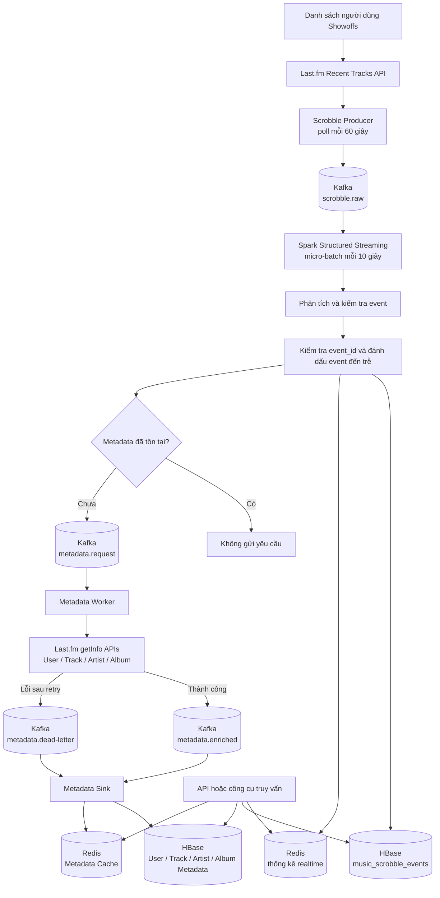

# Luồng xử lý nghe nhạc gần thời gian thực

Hệ thống thu thập dữ liệu nghe nhạc từ Last.fm theo chu kỳ và xử lý theo mô
hình **near real-time** (gần thời gian thực). Đây là Speed Layer; `foreachBatch`
của Spark là cơ chế micro-batch trong streaming, không phải Batch Layer xử lý
dữ liệu lịch sử.

## Sơ đồ tổng thể



## Luồng xử lý event

```text
Last.fm Recent Tracks
    → Scrobble Producer
    → Kafka: scrobble.raw
    → Spark Structured Streaming
       ├─ HBase: lưu event lâu dài
       ├─ Redis: thống kê và lịch sử gần đây
       └─ Kafka: metadata.request nếu thiếu metadata
```

Spark không loại event chỉ vì thời điểm nghe đã cũ. Mọi scrobble hợp lệ được
ghi idempotent vào HBase; Redis dùng `event_id` để tránh tăng thống kê nhiều
lần. Event đến trễ hơn ngưỡng cấu hình vẫn được xử lý và được lưu thêm trong
`music_late_events` để kiểm tra. Redis phục vụ kết quả đang được truy vấn
thường xuyên, còn HBase lưu event lâu dài.

## Luồng bổ sung metadata

```text
Kafka: metadata.request
    → Metadata Worker
    → Last.fm getInfo APIs
    → Kafka: metadata.enriched
    → Metadata Sink
       ├─ HBase Metadata
       └─ Redis Metadata Cache
```

Nếu Last.fm API vẫn lỗi sau các lần thử lại, worker gửi message vào
`metadata.dead-letter`. Metadata Sink lưu thông tin lỗi để có thể kiểm tra và
xử lý lại sau.

## Vì sao không thể xử lý realtime tuyệt đối?

Hệ thống không thể nhận scrobble ngay tại thời điểm người dùng bắt đầu hoặc
kết thúc bài hát vì nguồn Last.fm Recent Tracks hoạt động theo cách **polling**.
Last.fm không chủ động đẩy từng lượt nghe vào Kafka bằng webhook hoặc
WebSocket.

### 1. Producer phải gọi API theo chu kỳ

Producer hiện gọi Last.fm API mỗi 60 giây:

```text
Gọi Last.fm API → xử lý kết quả → chờ 60 giây → gọi lại
```

Nếu một scrobble xuất hiện ngay sau lần gọi trước, hệ thống có thể phải chờ gần
60 giây mới phát hiện được.

### 2. Bài đang phát chưa phải là scrobble hoàn chỉnh

Last.fm có thể trả về một bài đang phát với trạng thái:

```json
{
  "@attr": {
    "nowplaying": "true"
  }
}
```

Event này thường chưa có `date.uts` và chưa chắc sẽ trở thành một scrobble hợp
lệ. Người dùng có thể chuyển bài trước khi nghe đủ thời lượng. Hệ thống hiện
chỉ gửi các scrobble đã hoàn thành để tránh đếm sai hoặc ghi trùng.

### 3. Spark Streaming xử lý theo micro-batch

Spark Structured Streaming gom các event Kafka trong một khoảng thời gian ngắn
rồi mới xử lý. Trigger hiện tại là khoảng 10 giây:

```text
Event vào Kafka → chờ micro-batch → Spark xử lý → Redis/HBase
```

Đây vẫn là xử lý streaming, nhưng không phải xử lý tức thì từng mili-giây.

### 4. Không thể giảm polling quá thấp cho 500 người dùng

Nếu gọi API cho 500 người dùng mỗi 10 giây, số request ước tính là:

```text
500 người dùng × 6 lần/phút = 3.000 request/phút
```

Tần suất này gây tải lớn, dễ gặp giới hạn API và có thể khiến Last.fm từ chối
hoặc làm chậm request. Vì vậy cần cân bằng giữa độ trễ và số lượng API request.


## Điều kiện để đạt realtime thực sự

Muốn xử lý realtime thực sự, nguồn phát nhạc phải chủ động gửi event trực tiếp:

```text
Music Player
    → gửi event play/complete ngay lập tức
    → Kafka
    → Stream Processor
    → Redis/HBase
```

Nguồn dữ liệu cần hỗ trợ webhook, WebSocket hoặc tích hợp Kafka producer trực
tiếp trong ứng dụng phát nhạc. Khi chỉ sử dụng Last.fm Recent Tracks API, hệ
thống phù hợp nhất với mô hình near real-time.
